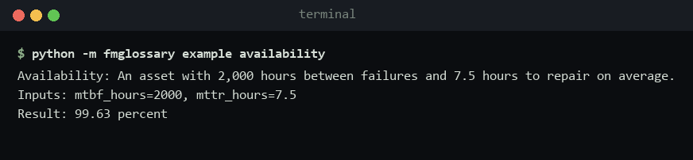

# facility-glossary-notes

Ten facility and maintenance terms (MTBF, MTTR, availability, PM compliance, reactive ratio, backlog, cost per square foot, FCI, EUI and service level) explained in plain words, each with its formula and a worked example that actually runs.



## What it is for

Facility and maintenance jargon is easy to nod along to and hard to calculate. This repo is a study aid and a small calculator: read the definition, see the formula, run the worked example, then put in your own numbers. It also exports the whole glossary as a Markdown page, `docs/glossary.md`, with every example result calculated by the code.

## Install

```
git clone https://github.com/yassine2med/facility-glossary-notes
cd facility-glossary-notes && pip install -r requirements.txt
```

## How to use

| I want to | Command |
|---|---|
| List the terms | `PYTHONPATH=src python -m fmglossary list` |
| Read a definition and see which inputs it needs | `PYTHONPATH=src python -m fmglossary define mtbf` |
| Run the worked example of a term | `PYTHONPATH=src python -m fmglossary example availability` |
| Calculate with my own numbers | `PYTHONPATH=src python -m fmglossary calc backlog_weeks open_work_hours=480 crew_hours_per_week=160` |
| Regenerate the Markdown glossary | `PYTHONPATH=src python -m fmglossary export -o docs/glossary.md` |
| Show help | `PYTHONPATH=src python -m fmglossary --help` |

Example:

```
PYTHONPATH=src python -m fmglossary example availability
```

Output:

```
Availability: An asset with 2,000 hours between failures and 7.5 hours to repair on average.
Inputs: mtbf_hours=2000, mttr_hours=7.5
Result: 99.63 percent
```

Run the tests with `python -m pytest -q`.

## How it works

1. Formulas are plain Python functions in `src/fmglossary/kpis.py`. A division by zero raises a clear error instead of a crash.
2. Each glossary entry in `glossary.py` holds the definition, the formula text, its unit and an example input set.
3. `example` runs the entry's own function on its example inputs, so the text and the number cannot drift apart.
4. `calc` takes `name=value` pairs and refuses missing, unknown or non-numeric inputs.
5. A test checks that `docs/glossary.md` is exactly what `export` produces now.

## Limits

- Ten terms only. Formulas follow common industry usage; your organization may define a term slightly differently.
- Example numbers are invented for teaching.
- No benchmarks: it does not say what a good value is for your building type.

## License

MIT. Yassine Emhamed, 2026.
